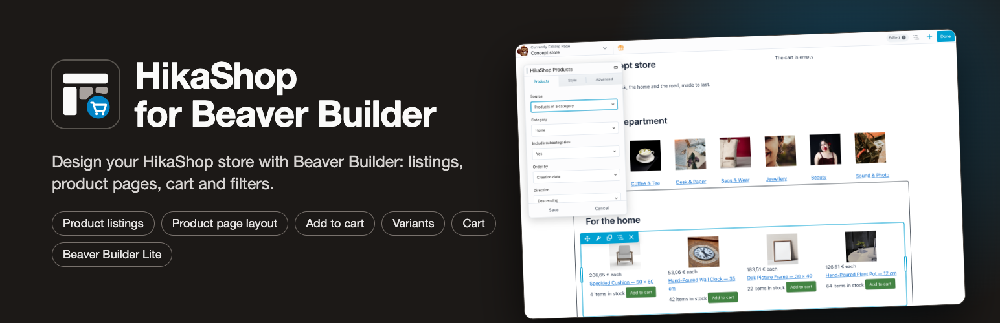
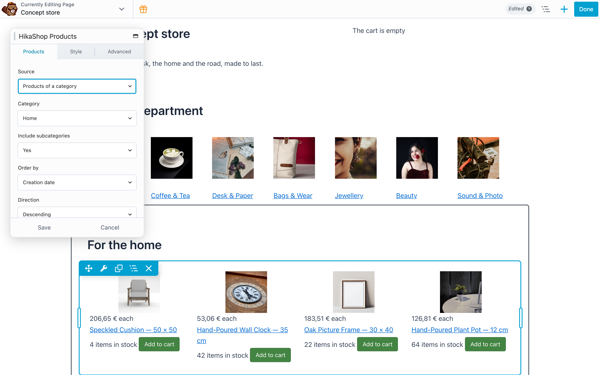
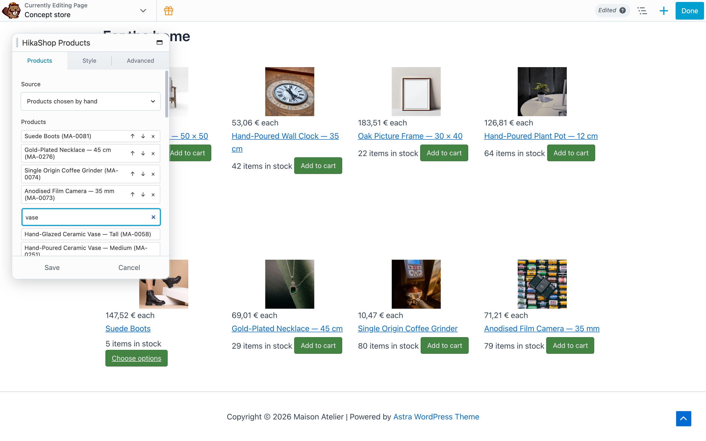
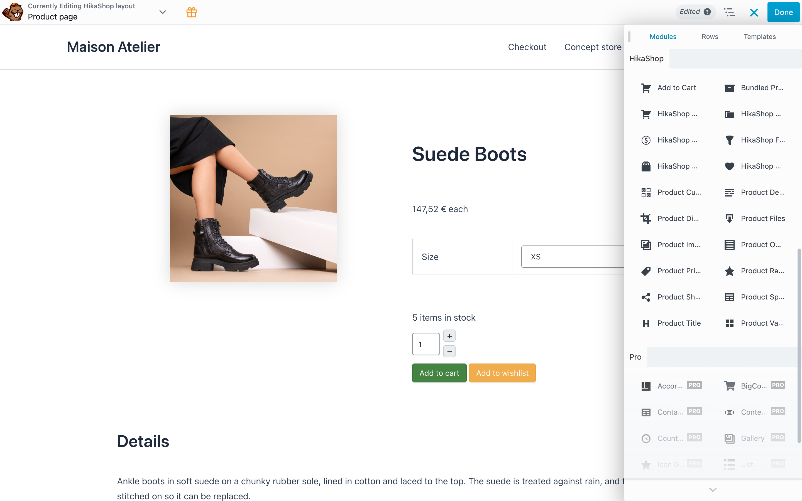
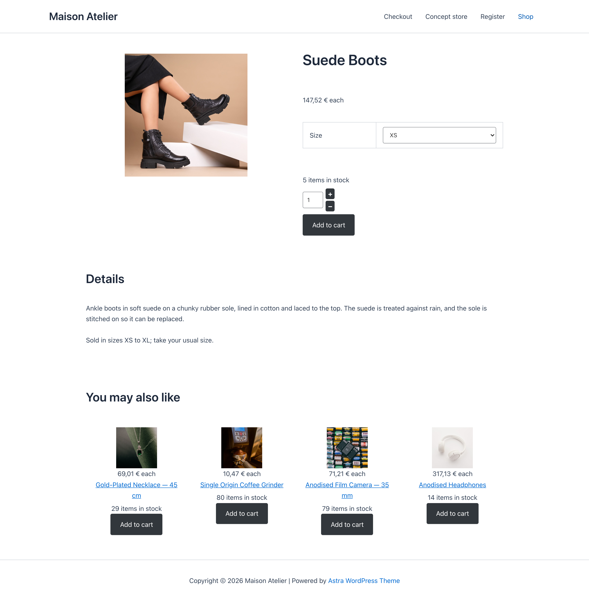
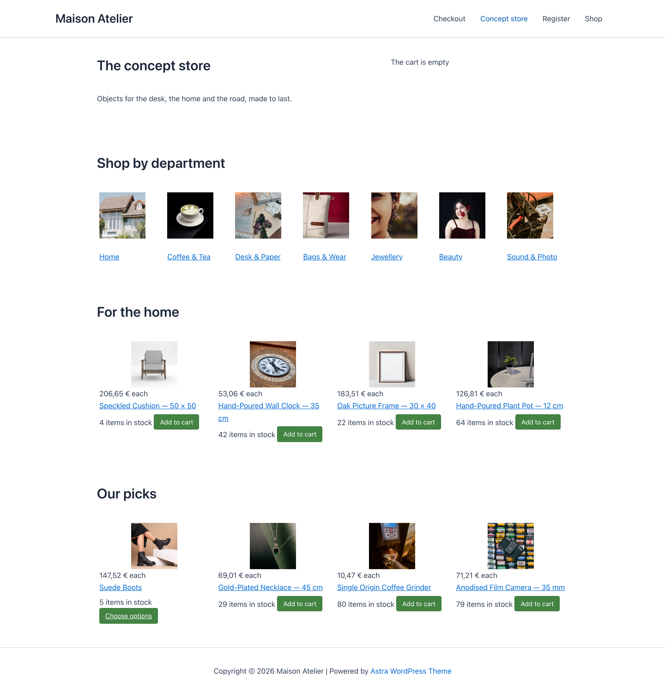
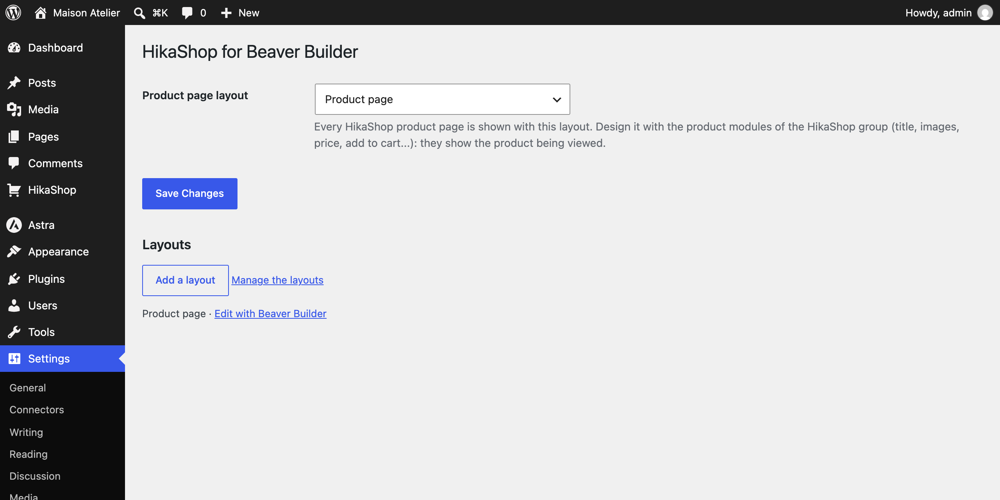

<p align="center">
  
</p>

<p align="center">
  <a href="https://github.com/hikashop-nicolas/hikashop-for-beaver-builder/actions/workflows/ci.yml"></a>
  
  
  
  
</p>

# HikaShop for Beaver Builder

Design a [HikaShop](https://www.hikashop.com) store with [Beaver Builder](https://www.wpbeaverbuilder.com). Product listings, category listings, every part of the product page, the cart, the wishlist, the currency switcher and the filters become Beaver Builder modules, and HikaShop product pages can be shown with a Beaver Builder layout.

It works with the **free Beaver Builder Lite**: nothing here needs the paid edition.



## What you get

| Module | What it shows |
|---|---|
| **HikaShop Products** | Products of a category (with or without its subcategories), products chosen by hand, products on sale, the visitor's recently viewed products, or the products related to the product being viewed. Order, number, columns, product layout, and whether to show the price, add to cart, quantity, wishlist, rating and badges. |
| **HikaShop Categories** | The subcategories of a category, with their product counts, empty ones hidden if you want. |
| **Product Title, Images, Price, Add to Cart, Description, Variants, Options, Custom Fields, Specifications, Dimensions, Bundled Products, Files, Rating, Sharing** | One part each of the product being viewed, to place anywhere in the product page layout. |
| **HikaShop Cart, Wishlist, Currency Switcher, Filters** | HikaShop's own modules, with their full settings one click away. |

Every module has a style tab (colors, typography, alignment) on top of HikaShop's own CSS.

### Products chosen by hand

The product picker searches the HikaShop catalog by name, code or id, and keeps the order you give.



### Product pages designed in Beaver Builder

Beaver Builder Lite has no saved templates, so the plugin adds its own: in *Settings > HikaShop for Beaver Builder*, add a layout, open it with Beaver Builder, lay out the product modules, publish it and pick it as the product page layout. Every HikaShop product page is then shown with it. In the builder the latest product of the shop stands in, so you see real content while you design. With the paid Beaver Builder, its saved layouts can be picked too.



A layout's own address answers 404 to anyone who cannot edit it, and is never indexed.

The variant selectors, the add to cart button, the image gallery and a link to a given variant (`?hikashop_char=`) behave as on HikaShop's own product page; unpublished products, products hidden from the visitor's user group or language still get HikaShop's own answer.



### A whole shop page



## Requirements

| | |
|---|---|
| WordPress | 6.8 or newer |
| PHP | 7.4 or newer |
| Beaver Builder | 2.9 or newer, Lite or paid |
| HikaShop | 6.8.2 or newer on WordPress, a package downloaded since 12 November 2026 (Starter, the free edition, works: [download it](https://www.hikashop.com/download)) |

If a requirement is missing, the plugin stays inactive and says which one in the admin.

## Installation

1. Install and activate HikaShop and Beaver Builder (or Beaver Builder Lite).
2. Install HikaShop for Beaver Builder from *Plugins > Add New* (once it is on WordPress.org), or upload the zip of the [latest release](https://github.com/hikashop-nicolas/hikashop-for-beaver-builder/releases).
3. Open a page with Beaver Builder: the modules are in the HikaShop group of the module panel.
4. For the product pages, add a layout in *Settings > HikaShop for Beaver Builder*, design it and choose it there.



## How it works

The plugin reimplements no shop logic, so prices, taxes, discounts, stock, access rights, the cart and the HikaShop layout overrides of your theme all apply as they do on HikaShop's own pages.

- **Listings** go through `hikashop_getLayout()` with module settings, the way HikaShop's own modules render.
- **Product parts** render HikaShop's product blocks (the ones of the WordPress site editor) for the product of the page.
- **Cart, wishlist, currency and filters** render HikaShop's WordPress widgets; their settings are stored by HikaShop under an id derived from the Beaver Builder node.
- **The product page layout** is a `hikashop_bb_layout` post edited with Beaver Builder, rendered through the `hikashop_wp_page_output` filter of HikaShop with `FLBuilder::render_content_by_id()`; its CSS and JavaScript are enqueued in the head. The page's title, meta description, canonical URL, Yoast SEO and Rank Math data and the product's structured data come from HikaShop, as on its own product page.
- **The builder** renders modules on the page itself and in its own requests on the site, so HikaShop renders as on the site there.
- **Output** is escaped with `wp_kses()` and an allowlist for HikaShop's forms; HikaShop's inline scripts and styles go through `wp_add_inline_script()` and `wp_add_inline_style()`.

## Development

```sh
bin/build.sh    # build/hikashop-for-beaver-builder/ and its zip, without the dev files
```

```
hikashop-for-beaver-builder.php   bootstrap
includes/class-plugin.php         requirements, module and field registration
includes/class-listing.php        product and category listings
includes/class-render.php         escaping, scripts and styles, site rendering scope
includes/class-layouts.php        layout post type, product page layout and its setting
includes/class-ajax.php           catalog search of the product picker
includes/modules/                 the modules
modules/hikashop/includes/        frontend.php and frontend.css.php shared by every module
fields/                           the product picker field template
assets/                           builder script and CSS, frontend CSS
.wordpress-org/                   WordPress.org icon, banners and screenshots
marketplace/                      HikaShop marketplace texts and pictures (not in the zip)
```

The listing, render and ajax classes are the ones of [HikaShop for Elementor](https://github.com/hikashop-nicolas/hikashop-for-elementor), under their own namespace, with the same file and method names: port a fix to both.

CI lints the PHP on 7.4, 8.1 and 8.4 and runs [Plugin Check](https://wordpress.org/plugins/plugin-check/) on the build: every category, experimental and low-severity checks included, in strict mode, so any error or warning fails the build. A release cannot be deployed without passing it.

## Release

1. Bump `Version` in `hikashop-for-beaver-builder.php`, `HIKASHOP_BB_VERSION`, `Stable tag` in `readme.txt`, and add the changelog entry to `readme.txt`.
2. Tag the commit with the version (`1.0.1`) and push the tag. The deploy workflow checks the versions match, runs Plugin Check, creates the GitHub release with the zip, and commits the release and the `.wordpress-org/` assets to the WordPress.org SVN.

The SVN credentials are the `SVN_USERNAME` and `SVN_PASSWORD` repository secrets; without them the workflow only makes the GitHub release. To send a version already released on GitHub to WordPress.org later, run the deploy workflow by hand on its tag.

## Support

Questions and bug reports: [GitHub issues](https://github.com/hikashop-nicolas/hikashop-for-beaver-builder/issues) or the [HikaShop forum](https://www.hikashop.com/forum).

## License

GPLv2 or later. Beaver Builder is a trademark of its owner; this plugin is not made or endorsed by the makers of Beaver Builder.
